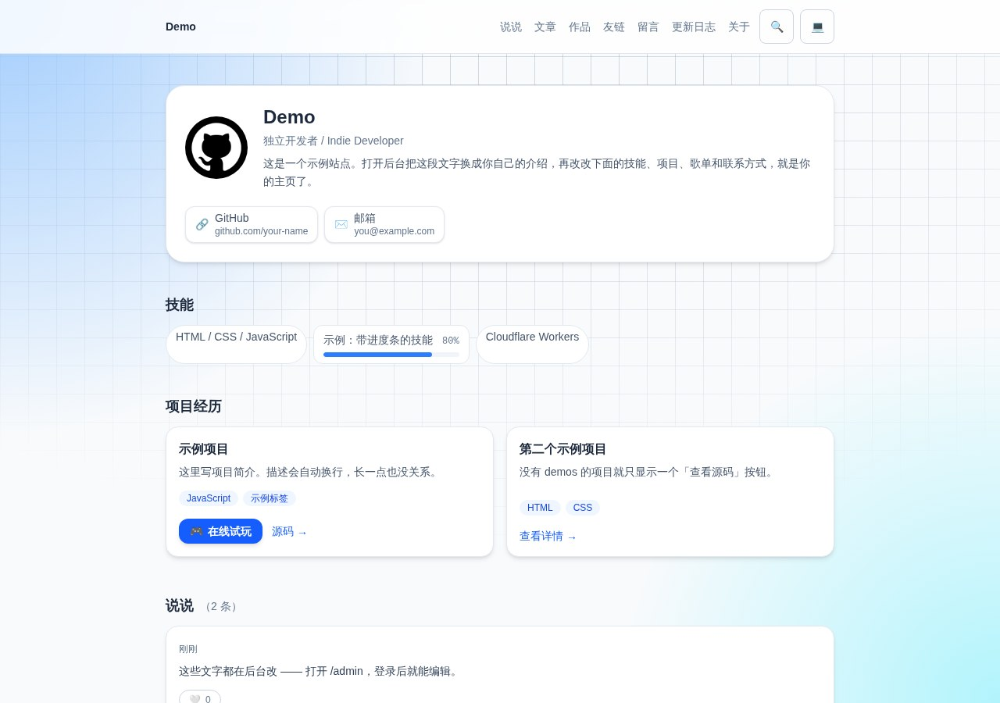
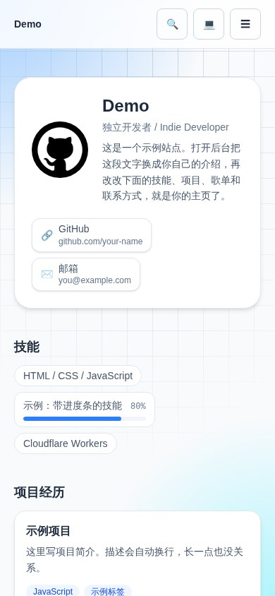
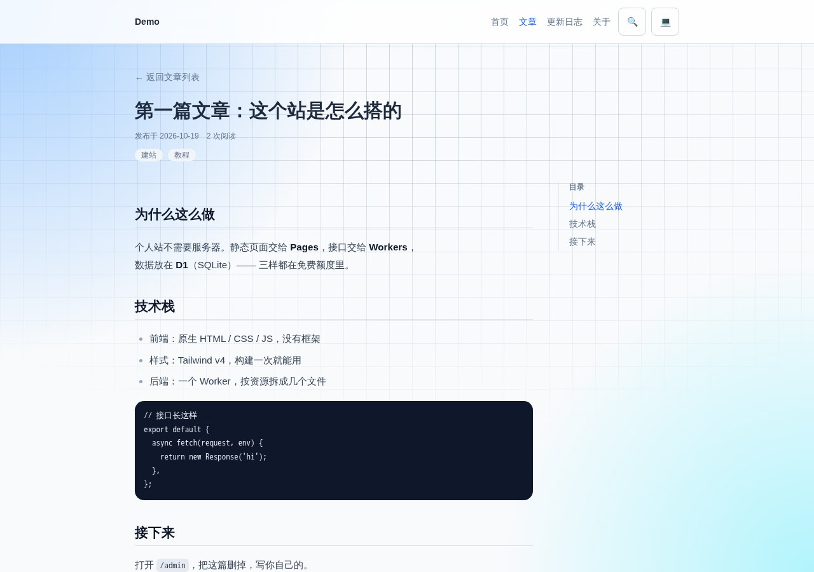
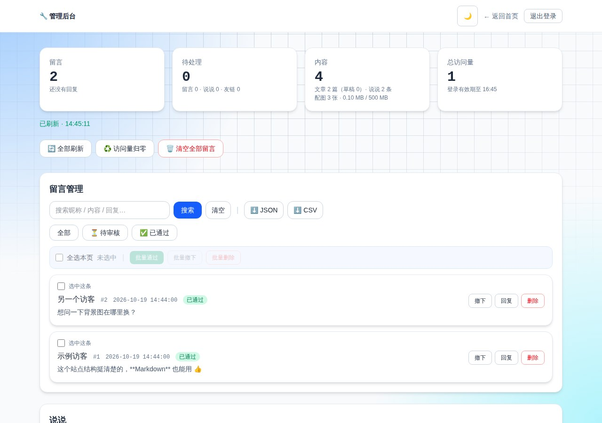

# profile-kit

A personal homepage that runs entirely on Cloudflare's free tier.
**Pages + Workers + D1** — no server, no build step required for the frontend, no monthly bill.

[中文说明](README.zh-CN.md) · [Deployment guide](DEPLOY.md)

Using an AI agent? Point it at [AGENTS.md](AGENTS.md) first — it covers where things
live and the five gotchas that will otherwise waste an afternoon. [llms.txt](llms.txt)
has a machine-readable index.



<p align="center">
  
  &nbsp;&nbsp;
  
  &nbsp;&nbsp;
  
</p>

---

## What's in it

A full personal site, not just a landing page:

| | |
| --- | --- |
| **Profile** | Avatar, tagline, bio, skills (with optional progress bars), projects, playlist, contacts — all editable from the admin panel or a single constant in `worker.js` |
| **Moments** | Short posts with images, likes, pagination |
| **Gallery** | Image grid with lightbox |
| **Articles** | Markdown articles with server-side rendering, TOC, reading progress, tags, archive, related posts, and per-article social preview cards |
| **Guestbook** | Nested replies, likes, markdown, image attachments, spam filtering, optional Turnstile, manual approval |
| **Changelog** | Dated release notes, editable from the admin panel |
| **Friends** | Blogroll with avatar auto-fetch |
| **Search** | Cross-content search over articles, moments and guestbook |
| **Admin** | 12 panels, password login, audit log, backup & restore, self-check |

Plus the unglamorous parts that usually get skipped: RSS feeds, sitemap, PWA with offline support, dark mode, accessible touch targets, and **914 end-to-end assertions**.

---

## Deploy

[](https://deploy.workers.cloudflare.com/?url=https://github.com/sb1145148/profile-kit)

> ⚠️ The button deploys **the Worker only**. You still need to create the D1 database and deploy the frontend — both are 2 commands. See **[DEPLOY.md](DEPLOY.md)** for the full walkthrough (~15 minutes).

Manual, if you prefer:

```bash
git clone https://github.com/sb1145148/profile-kit
cd profile-kit
npm install

npx wrangler d1 create your-site-db      # put the id into wrangler.toml
npx wrangler d1 execute your-site-db --remote --file=./worker/schema.sql
npx wrangler secret put ADMIN_PASSWORD   # your admin password

npx wrangler deploy                      # the API
cd frontend && npx wrangler pages deploy . --project-name=your-site
```

Then open `/admin` on your deployed site and log in.

---

## Architecture

```
frontend/            Static site, served by Cloudflare Pages
  *.html             One file per page — no SPA router, no build for HTML
  app.js pages.js    Page logic, one file per concern
  core.js            Shared: theme, header, API client, markdown helpers
  media.js           Client-side image thumbnails (see below)
  sw.js              Service worker — offline cache
  functions/         Pages Functions: /a/<slug> (OG tags), sitemap.xml
  tailwind.css       Precompiled Tailwind v4 (only when you change classes)

worker/              API, served by Cloudflare Workers
  worker.js          Router + the PROFILE constant + helpers
  routes/            One file per resource: posts, articles, friends, misc, system
  lib/               markdown, spam filter, turnstile, audit log, backup
  schema.sql         Full D1 schema — run once on a fresh database
  migrations/        Incremental migrations for existing databases

tests/               914 end-to-end assertions, no Cloudflare account needed
build/               Tailwind input + a release script that hashes assets
```

**Why no framework?** A personal site has a handful of pages and a little dynamic
content. Vanilla JS keeps the whole thing auditable, deployable in seconds, and
free forever. The tradeoff is that you write more DOM code — which is fine at
this size.

---

## Customizing

**Your profile** lives in one place — the `PROFILE` constant at the top of
`worker/worker.js`. Edit it and redeploy the Worker:

```js
const PROFILE = {
  name: 'Demo',
  tagline: 'Indie Developer',
  skills: ['JavaScript', { name: 'Rust', level: 60 }],
  projects: [{ title: '…', desc: '…', link: '…', demos: [{ label: 'Live', url: '…' }] }],
  contacts: [{ label: 'GitHub', value: 'github.com/you', link: 'https://github.com/you' }],
  // …
};
```

**Everything else** — posts, articles, photos, guestbook, changelog, settings —
is stored in D1 and edited from `/admin`.

**Colors and themes** are Tailwind classes plus CSS variables in
`frontend/style.css`. If you add or change utility classes, rebuild:

```bash
npm run css        # then npm run release
```

---

## Interesting bits

**Image thumbnails without a paid plan.** Pages renders gallery images at ~280px
but the lightbox needs the original. Downloading a 800 KB photo to fill a small
tile wasted 90% of the page weight. Cloudflare's on-the-fly image resizing is a
paid add-on, so the browser generates a 640px JPEG (`canvas`) at upload time and
ships both. Grids request `/api/media/<token>?s=thumb`; the lightbox keeps the
original. Images without a thumbnail fall back to the original, so nothing 404s.
Result: homepage transfer dropped from **1.86 MB to 179 KB**.

**Markdown is rendered server-side, escape-first.** Input is HTML-escaped, *then*
Markdown rules are applied, so raw HTML can never sneak through. Mentions become
placeholders before escaping so they can render as buttons afterwards.

**Offline actually works.** The service worker precaches both the `.html` files
and the pretty URLs (`/changelog` as well as `/changelog.html`) — a subtle bug
that made every page except the homepage fail offline until it was fixed.

---

## Tests

```bash
cd tests
npm install && npx playwright install chromium
npm test
```

914 assertions across 9 suites. No Cloudflare account, no network — a local
server replays `worker/worker.js` against an in-memory SQLite standing in for D1,
and Playwright drives a real browser. See [tests/README.md](tests/README.md).

---

## License

Code is [MIT](LICENSE).

Content is not. The demo text, screenshots and images are placeholders for you to
replace — please don't republish this repo's demo content as your own.
